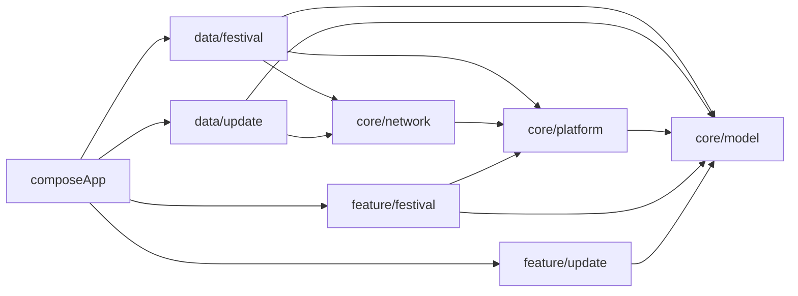

# Архитектура Cosplay 2

Cosplay 2 — Kotlin Multiplatform приложение для просмотра фестивалей cosplay2.ru.
Платформы: Android и Desktop JVM. Интерфейс использует Compose Multiplatform и Material 3.
Модули подключены в `settings.gradle.kts`.

## Модули и структура проекта

| Модуль | Ответственность |
| --- | --- |
| `composeApp` | Точки входа Android/Desktop, тема, навигация и создание зависимостей |
| `core/model` | DTO сериализации, модели фестивалей и состояние установки обновлений |
| `core/network` | Фабрика Ktor HttpClient с платформенными движками |
| `core/platform` | Платформенные реализации загрузки изображений, логов, версии, back handler и установки обновлений |
| `data/festival` | API cosplay2.ru, HTML/JSON-LD парсинг и репозиторий фестивалей |
| `data/update` | Запрос GitHub Releases и преобразование релиза в AppUpdateInfo |
| `feature/festival` | Экран списка, фильтры, карточки и экран деталей фестиваля |
| `feature/update` | Баннер обновления и экран установки новой версии |

Основная структура Kotlin-кода: `src/commonMain/kotlin/ru/flobsterable/cosplay2/`.
Платформенный код находится в `androidMain` и `desktopMain`.

## Зависимости между модулями

Зависимости заданы в build.gradle.kts каждого модуля:

- composeApp подключает все семь core/data/feature-модулей и создаёт их зависимости.
- data/festival зависит от core/model, core/network и core/platform.
- data/update зависит от core/model и core/network.
- feature/festival зависит от core/model и core/platform.
- feature/update зависит от core/model.
- core/network зависит от core/platform; core/platform — от core/model.
- core/model не подключает другие внутренние модули.

Схема выделяет основные транзитивные связи; composeApp также напрямую подключает core-модули.

## Создание зависимостей и навигация приложения

`composeApp/src/commonMain/kotlin/ru/flobsterable/cosplay2/App.kt` содержит `CosplayApp`.
В нём создаются `createHttpClient()`, `CosplayRepositoryImpl(CosplayApiImpl(client))`
и `GitHubUpdateRepository` для репозитория `Flobsterable/cosplay-2`.
HttpClient закрывается при выходе composable из композиции через DisposableEffect.

Закрытый тип AppRoute задаёт экраны Festivals, FestivalDetails и Update.
Переключение экранов реализовано через AnimatedContent; обработка возврата — SystemBackHandler.
Данные загружаются в produceState и отображаются через UiState: Loading, Success или Error.

## Получение и отображение фестивалей

`CosplayRepositoryImpl.getFestivalCatalog(year)` получает список фестивалей, типы событий
и дополнительные JSON-LD данные архива. DTO преобразуются в FestivalSummary.
`FestivalsRoute` сортирует список по startTime перед передачей экрану.
Фильтрация списка реализована в `feature/festival/.../FestivalListScreen.kt`.
Выбор года в App.kt вызывает загрузку каталога заново.

Подробный порядок загрузки, поиска, фильтрации и обновлений — в [feature-flows.md](feature-flows.md).
Схема DTO и доменных моделей — в [data-model.md](data-model.md).

При выборе фестиваля создаётся маршрут FestivalDetails. Репозиторий получает детали,
а FestivalDetailScreen отображает результат. Сетевые контракты описаны в `docs/festival-api.md`.

## Сеть и платформенные интеграции

`core/network/.../HttpClientFactory.kt` объявляет expect-функцию createHttpClient.
Android-реализация использует OkHttp, Desktop — CIO. Оба клиента включают
ContentNegotiation с kotlinx.serialization и Logging через AppLogger.

`core/platform` содержит expect/actual-интеграции. Например, AppUpdateLauncher на
Android отвечает за скачивание APK и системную установку; Desktop открывает ссылку.

## Где менять код

- Новый фильтр списка: `feature/festival/.../FestivalListScreen.kt`, при необходимости также модели и API.
- Новый сетевой запрос фестивалей: `data/festival/.../CosplayApi.kt` и репозиторий.
- Изменение общей модели: `core/model/.../Models.kt`.
- Новый экран или переход: соответствующий feature-модуль и App.kt.
- Обновления приложения: `data/update`, `feature/update`, `core/platform`.
