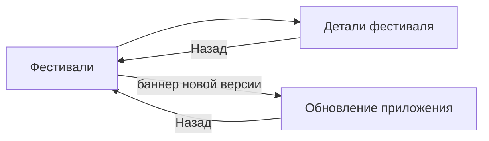

# Фичи, экраны и пользовательские флоу

Cosplay 2 помогает выбрать фестиваль на cosplay2.ru, посмотреть подробности и
перейти к действиям на сайте события. Один общий интерфейс работает на Android
и Desktop JVM. Документ описывает текущее поведение исходников. Состав опубликованного
APK определяется его версией и тегом релиза: наличие экрана в исходниках само по
себе не означает, что он вошёл в установленную версию приложения.

## Что реализовано

| Возможность | Поведение | Статус |
| --- | --- | --- |
| Каталог фестивалей | Загрузка с cosplay2.ru, сортировка по дате начала, карточки с афишей, названием, датами, местом и описанием | Реализовано |
| Поиск | По названию, городу и описанию без учёта регистра; применяется к уже загруженному каталогу | Реализовано |
| Категории | Все, косплей, танцевальные, конвенты, вечеринки, ярмарки и разное | Реализовано |
| Год и месяц | Смена года загружает другой каталог; месяц фильтрует по дате начала события | Реализовано |
| «Актуальные» | Каталог текущего года с дополнительным фильтром `FestivalStatus.Future`, полученным из серверного `timestatus` | Реализовано |
| Детали фестиваля | Афиша, даты, место, описание, текст и ссылки страницы события; раскрываемый раздел «О фестивале» | Реализовано |
| Внешние действия | Открытие страницы фестиваля и ссылок из описания; шаблон события в Google Calendar | Реализовано; действия завершаются во внешнем приложении/браузере |
| Обновления | Поиск версии в GitHub Releases, баннер и отдельный экран обновления | Реализовано; установка зависит от платформы |

Экранные действия и состояния перечислены ниже; реализация UI описана в [screens.md](screens.md).
Порядок запросов и обработка данных — в [сценариях приложения](feature-flows.md).

## Карта переходов

На Android системная кнопка Back повторяет эти возвраты. Открытие браузера или
Google Calendar — внешнее действие, а не новый маршрут приложения.

## 1. Фестивали

**Назначение:** найти событие и открыть его карточку. Это стартовый экран.

**Что отображается:**

- поле поиска по названию, городу или описанию;
- баннер найденного обновления, если есть новая версия либо незавершённое обновление;
- категории событий, выбор года/«Актуальные» и выпадающий список месяцев;
- карточки: афиша, название, тип, статус «Скоро»/«Архив», даты, город/страна и
  краткое описание. При отсутствии URL афиши используется заглушка с названием.

**Действия:** вводить поиск, комбинировать фильтры, выбирать карточку, открыть
экран обновления. Только смена года вызывает новую загрузку каталога;
поиск, месяц и категория фильтруют имеющиеся данные. Правила «Актуальных» и диапазон
годов приведены в [features.md](features.md).

**Состояния:** загрузка; список; пустой результат после фильтрации; ошибка.
При смене года отображается загрузка, а последний успешный каталог используется
для сохранения контекста фильтров. У блока ошибки каталога нет отдельной кнопки
повтора. Встроенные демонстрационные данные могут прийти как успешный каталог;
подробнее — [диагностика](troubleshooting.md).

**Состояние при переходах:** значения поиска, категории, месяца и года находятся
в composable каталога. Отдельного владельца для их сохранения при переходах
между экранами нет. При возврате каталог загружается заново; восстановление
фильтров не является гарантированным сценарием. При смене года месяц сбрасывается.
Сохранение данных API между запусками не реализовано.

## 2. Детали фестиваля

**Вход:** нажатие карточки в каталоге. **Возврат:** в каталог.

**Что отображается:** крупная афиша и название; тип и статус события; даты и место;
раскрываемый раздел «О фестивале». Описание объединяет краткую информацию и текст
страницы события, убирая повторяющиеся абзацы. Доступные ссылки могут отображаться
в тексте и отдельными кнопками внутри раскрытого раздела.

**Действия:** раскрыть/свернуть описание, перейти по ссылке, нажать «Открыть страницу
фестиваля» или «Добавить в календарь». Последнее открывает шаблон Google Calendar;
событие сохраняет сам пользователь. Подставляемые часы не заменяют расписание на сайте.

**Состояния:** загрузка деталей, успешные данные, ошибка. Кнопка возврата доступна
во всех трёх состояниях. При неполных данных используется доступная информация
карточки и резервный текст; это не отдельный экран «нет данных».

**Состояние при переходах:** детали создаются при открытии выбранной карточки.
Не следует ожидать восстановления раскрытых секций после выхода и повторного входа.

## 3. Обновление приложения

**Вход:** «Открыть обновление» в баннере каталога. **Возврат:** в каталог.

Экран показывает найденную версию и раздел «Что нового», если релиз содержит
непустые примечания. Источник — GitHub Releases, не Google Play.

| Состояние | Что видит пользователь | Действие |
| --- | --- | --- |
| Информация о релизе ещё отсутствует (`update == null`) | Индикатор загрузки | Дождаться данных или вернуться |
| Готово к загрузке (`Idle`) | Найденная версия | «Загрузить обновление» |
| Загрузка (`Downloading`) | Количество байтов и прогресс; проценты, если известен размер | Дождаться завершения |
| Загружено (`Downloaded`) | APK находится на устройстве | «Установить обновление» |
| Нужно разрешение (`RequiresInstallPermission`) | Объяснение ограничения Android | «Открыть настройки разрешения», затем «Проверить снова» |
| Ошибка (`Failed`) | Текст ошибки | «Попробовать снова» |

Скачивание, прогресс и установка APK относятся к Android. На Desktop действие
загрузки открывает URL APK, а при его отсутствии — страницу релиза в браузере;
состояния Android-установщика там не используются. Общий UI при этом сохраняет
Android-ориентированные подписи кнопок. Встроенного обновления Desktop-пакета нет.

Ошибка получения релиза сейчас не имеет отдельного блока в UpdateRoute: если
релиз и pendingUpdate отсутствуют, экран остаётся с индикатором. Это ограничение
текущей реализации, а не отдельное реализованное состояние ошибки API.

## Основные пользовательские флоу

### Найти фестиваль и изучить подробности

Каталог → поиск или выбор категории/года/месяца → карточка фестиваля → детали →
раскрытие описания. Пользователь может открыть страницу фестиваля или ссылку из
описания во внешнем браузере, а затем вернуться в приложение. Кнопка «Назад»
в деталях возвращает в каталог; данные загружаются заново.

### Запланировать посещение

Каталог → детали фестиваля → «Добавить в календарь» → форма Google Calendar →
проверка дат, времени и места → сохранение пользователем. Приложение только
подготавливает URL формы; отдельного внутреннего календаря и автоматического
сохранения события нет.

### Обновить приложение

Каталог → баннер новой версии → «Открыть обновление» → сведения о релизе →
«Загрузить обновление». На Android следуют загрузка APK, выдача разрешения источнику
при необходимости и системный установщик с подтверждением пользователя. Если
возникла ошибка, экран предлагает повторить загрузку. На Desktop этот шаг открывает
ссылку в браузере, дальнейшая загрузка и установка выполняются вне приложения.

## Платформенные различия

| Действие | Android | Desktop JVM |
| --- | --- | --- |
| Просмотр каталога, фильтры и детали | Общий Compose UI | Общий Compose UI |
| Возврат | Кнопки интерфейса и системный Back | Кнопки интерфейса; системный back handler ничего не делает |
| Обновление | Скачивание APK, показ прогресса, запрос разрешения источника при необходимости, системный установщик | Открытие ссылки на APK или страницы релиза в браузере; встроенной установки нет |
| Календарь и ссылки | Передача URL обработчику ссылок системы | Передача URL обработчику ссылок системы |

«Добавить в календарь» открывает форму Google Calendar, но не сохраняет событие
автоматически и не запрашивает доступ к календарю. Шаблон подставляет название,
описание и место; время начала/конца задано в коде как 12:00/20:00 и не является
подтверждённым расписанием фестиваля.

## Данные и ограничения

- Каталог принадлежит cosplay2.ru. Собственного сервера или базы фестивалей в
  приложении нет; поиск работает только по загруженному году.
- При ошибке загрузки списка репозиторий может вернуть встроенные демонстрационные
  события с `isFallback=true`. Это фиксированные примеры, а не офлайн-копия сайта
  или кэш последнего успешного ответа. Ошибка справочника типов сама по себе не
  делает каталог демонстрационным.
- В UI доступны «Актуальные» и годы от текущего до `maxOf(2013, currentYear - 6)`;
  год загруженного каталога добавляется, если его нет в этом диапазоне.
- UI каталога владеет своими фильтрами; отдельного сохранения при переходах нет.
  Сетевые результаты на диске не хранятся, каталог загружается при повторном открытии.
- В текущем клиенте нет входа, профиля, избранного, покупки билетов и регистрации
  на фестиваль. Ссылки на такие действия могут вести на внешний сайт.

## Проверяемые пользовательские сценарии

1. Открыть каталог, выбрать категорию и месяц, найти событие по городу; открыть
   детали и вернуться. Каталог должен загрузиться заново; сохранение фильтров
   при таком переходе не гарантируется.
2. Выбрать другой год — дождаться новой загрузки; месяц должен сброситься на
   «Все месяцы». В «Актуальных» должны остаться только события со статусом Future.
3. В деталях раскрыть описание, открыть страницу фестиваля и форму календаря;
   проверить содержимое формы перед сохранением во внешнем сервисе.
4. При доступном обновлении открыть баннер. На Android проверить загрузку,
   разрешение и установщик; на Desktop — открытие браузера.

Это перечень сценариев для ручной проверки, а не отчёт об их выполнении.

## Где подтверждается реализация

- [Навигация и загрузка экранов](../composeApp/src/commonMain/kotlin/ru/flobsterable/cosplay2/App.kt).
- [Каталог и фильтры](../feature/festival/src/commonMain/kotlin/ru/flobsterable/cosplay2/feature/festival/FestivalListScreen.kt).
- [Детали и внешние действия](../feature/festival/src/commonMain/kotlin/ru/flobsterable/cosplay2/feature/festival/FestivalDetailScreen.kt).
- [Экран обновления](../feature/update/src/commonMain/kotlin/ru/flobsterable/cosplay2/feature/update/UpdateScreen.kt).
