Снимок фактического локального прогона до создания коммита PR. В run.json указан базовый commit и SHA-256 проверенных исходников с рабочими изменениями. Это исторический результат, а не проверка нового commit SHA или удалённого CI. Исходные журналы и JUnit XML остаются локально в build/verification/run-20261024; скриншоты и результаты шагов сохранены здесь.

# Проверка Cosplay 2

Запуск: 24 октября 2026, 02:50:52 +06:00; commit: 0e092fe94f816674085a016f342bad9683788173; source SHA-256: ceaf98c89b6992708bf827a88c7bff523d56a829a4383739892045d0f086da98.

## Уровень 1 — код

- tests: exit 0, локальный журнал tests.log; `:core:model:desktopTest :data:festival:desktopTest :data:update:desktopTest :core:platform:desktopTest :composeApp:desktopTest --console=plain -I docs/build-upgrade/maven-mirror.init.gradle.kts`.
- compile: exit 0, локальный журнал compile.log; `:composeApp:compileKotlinDesktop :composeApp:compileAndroidMain --console=plain -I docs/build-upgrade/maven-mirror.init.gradle.kts`.
- lint: exit 0, локальный журнал lint.log; `:androidApp:lintDebug --console=plain -I docs/build-upgrade/maven-mirror.init.gradle.kts`.

| Модуль | Тесты | Failures | Errors | Skipped |
| --- | ---: | ---: | ---: | ---: |
| core/model | 5 | 0 | 0 | 0 |
| data/festival | 5 | 0 | 0 | 0 |
| data/update | 7 | 0 | 0 | 0 |
| core/platform | 12 | 0 | 0 | 0 |
| composeApp | 40 | 0 | 0 | 0 |

Всего тестов: 69. При неуспешной команде XML может относиться к прошлой сборке и не подтверждает текущий запуск.

## Уровень 2 — UI через MCP

Платформа: Desktop JVM / Windows. Инструмент: MCP Computer Use / node_repl / @oai/sky. Сборка: Текущие локальные исходники; gradle APP_VERSION_NAME=1.0.2; Desktop UI показывает 1.0.0; запущено :composeApp:run; APPDATA=build/verification/initial/appdata; Ограничения: Android UI не прогонялся; GitHub Actions удалённо не запускался. Новые 17 тестов прошли с первого запуска (локальный ../initial/new-tests.log).

### S01 — Каталог: поиск, пустой результат и восстановление: PASS

- S01-1 PASS: Каталог загрузился: найдено 64 фестиваля, показаны карточки; демонстрационный fallback не отображается.
  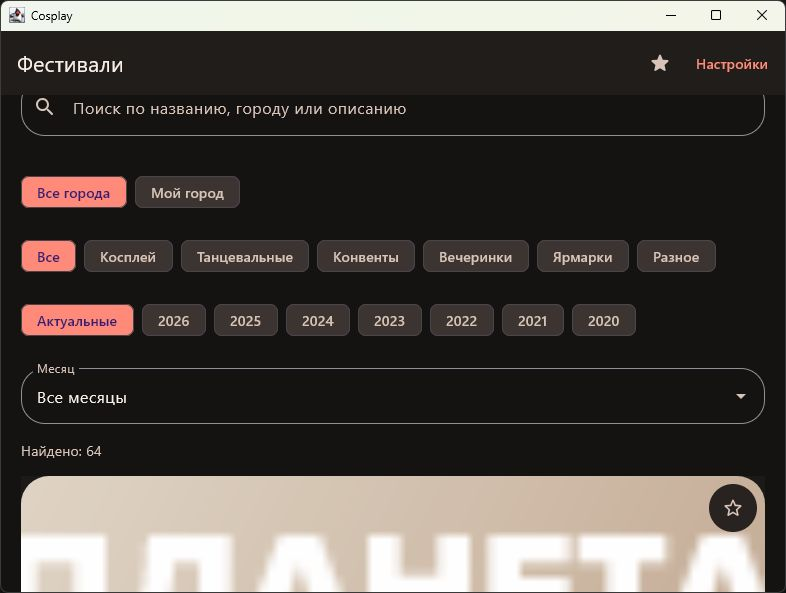
- S01-2 PASS: Поиск «Планета Косплея» сократил каталог с 64 до 1 карточки.
  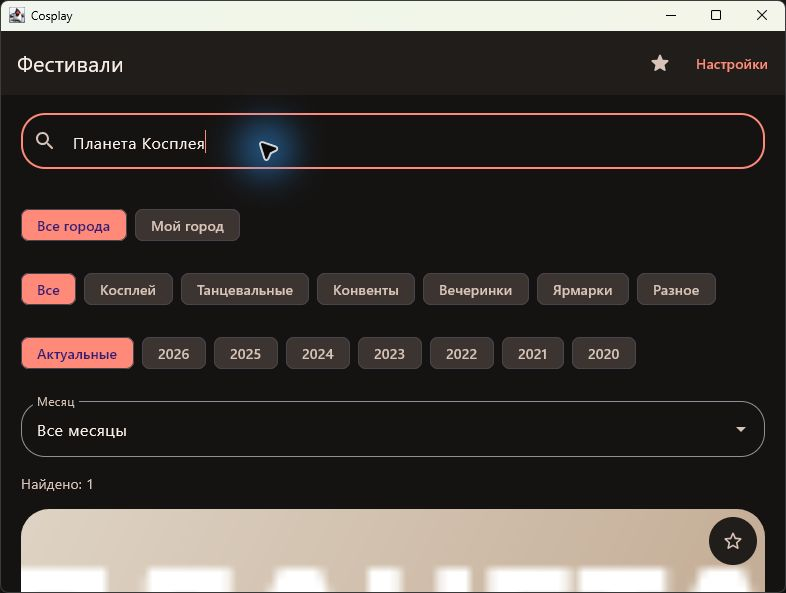
- S01-3 PASS: Для SMOKE_NO_MATCH_7429 показано «Ничего не найдено» и совет снять фильтр или сократить запрос.
  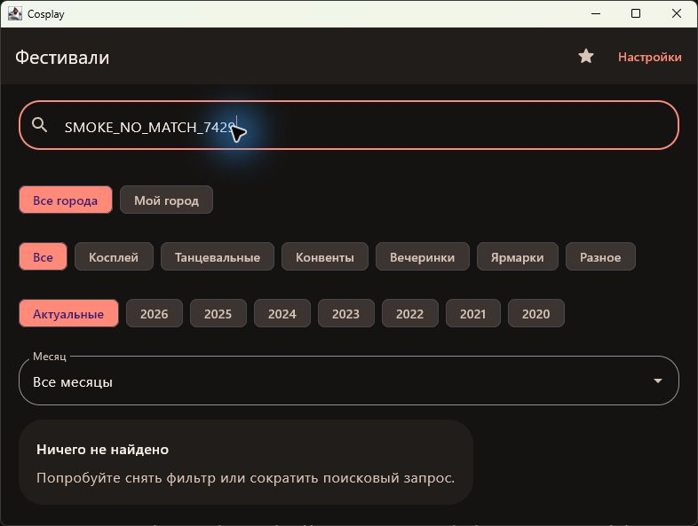
- S01-4 PASS: После очистки запроса снова найдено 64 фестиваля, карточки восстановлены.
  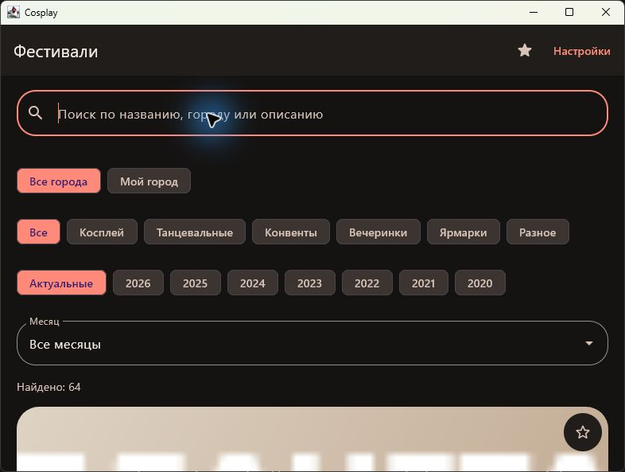
Диагностика: Нарушений ожидаемого поведения не обнаружено.

### S02 — Год, месяц и сохранение фильтров: PASS

- S02-1 PASS: Выбран 2026 год, после загрузки найдено 360 событий; старый список не показан во время загрузки. Год API отдельно подтверждается кодовыми тестами.
  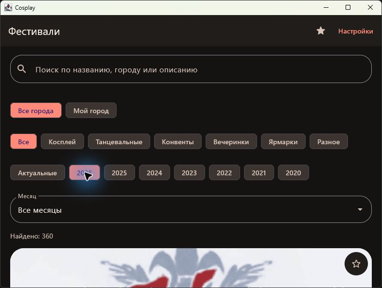
- S02-2 PASS: Выбран Январь 2026: вместо 360 найдено 23 события.
  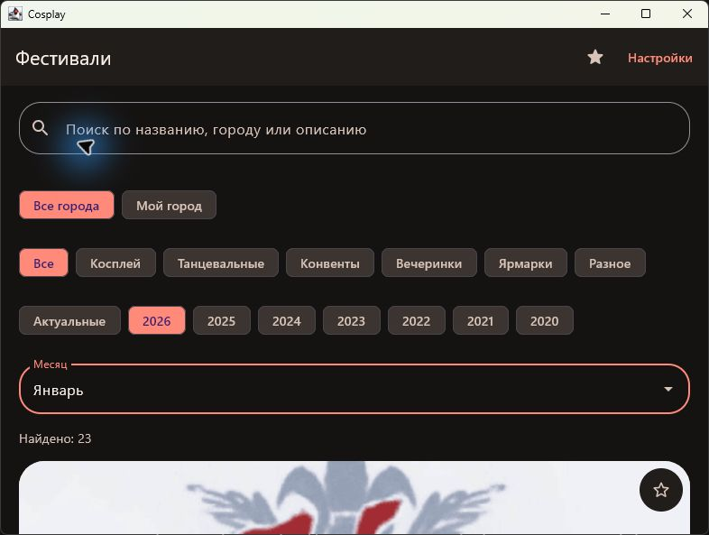
- S02-3 PASS: После Настройки → Назад сохранены 2026 и Январь. Дополнительный снимок: screenshots/S02-3-settings.png.
  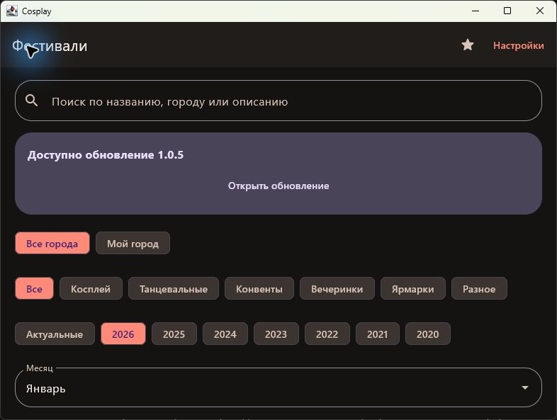
- S02-4 PASS: Выбран 2025; месяц автоматически сброшен с Января на Все месяцы.
  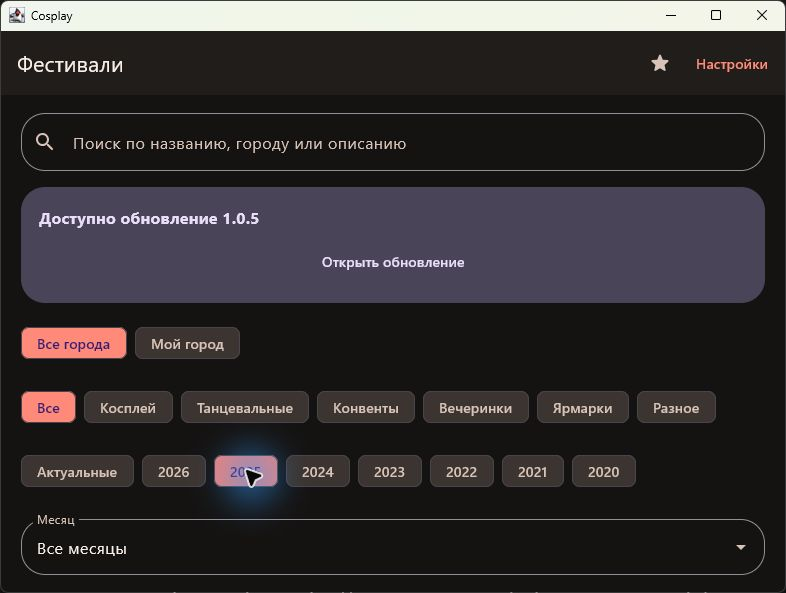
Диагностика: Нарушений ожидаемого поведения не обнаружено.

### S03 — Избранное: добавление, детали, возврат и удаление: PASS

- S03-1 PASS: У «Необычный Новый год!» звезда стала заполненной. Перед добавлением проверено пустое избранное: screenshots/S03-precondition.png.
  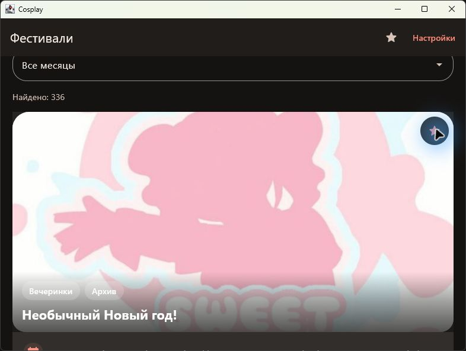
- S03-2 PASS: В Избранном появилась карточка «Необычный Новый год!», Набережные Челны, 3 января.
  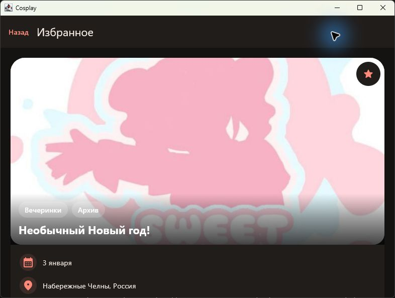
- S03-3 PASS: Открыты детали «Необычный Новый год!»: 3 января 2025, звезда активна.
  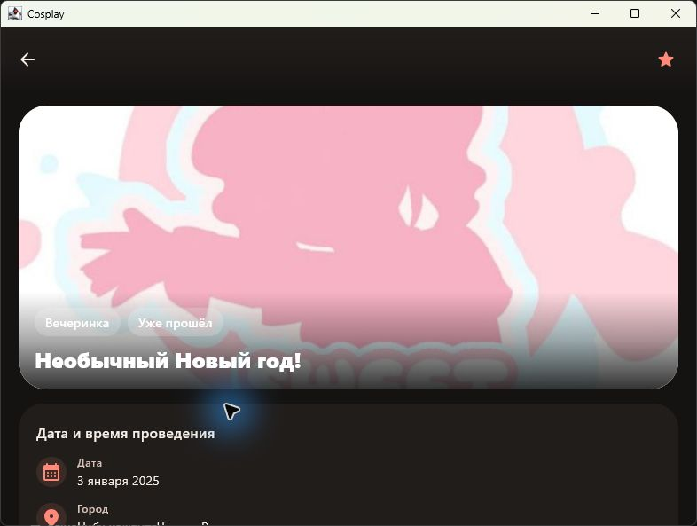
- S03-4 PASS: Назад из деталей вернул в Избранное, карточка «Необычный Новый год!» осталась.
  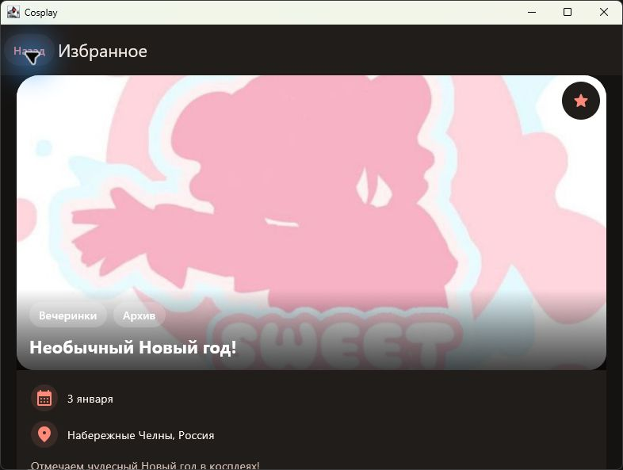
- S03-5 PASS: Только добавленная тестом запись удалена: карточек нет, показано «Добавьте фестивали в избранное».
  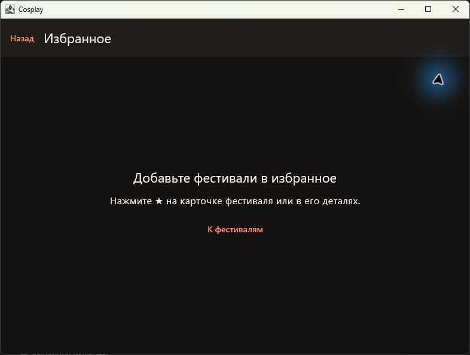
Диагностика: Нарушений ожидаемого поведения не обнаружено.

### S04 — Мой город: выбор и фильтрация: PASS

- S04-1 PASS: В Настройках открыт диалог «Мой город» с полем Город; Сохранить неактивно до ввода.
  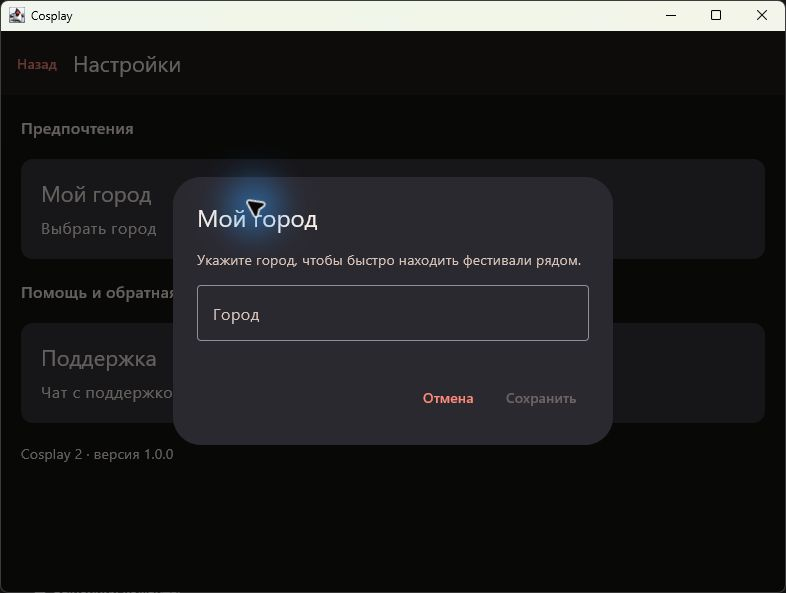
- S04-2 PASS: После сохранения в Настройках указан город Набережные Челны. Ввод: screenshots/S04-2-input.png.
  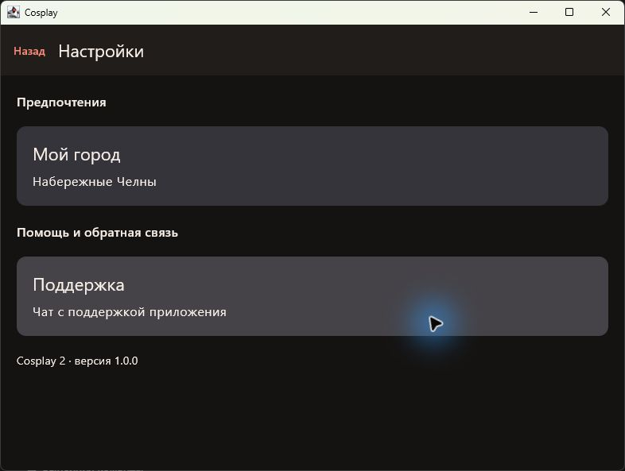
- S04-3 PASS: Фильтр Мой город: Набережные Челны активен; найдено 4 события вместо 336. Активный фильтр: screenshots/S04-3-filter.png. Проверены все четыре карточки: Необычный Новый год!, CH.FLEX FEST, Arkana Fest, Рубикон — Набережные Челны; screenshots/S04-3-city-1.png … S04-3-city-4.png.
  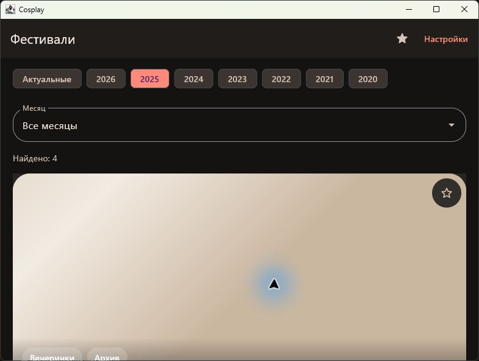
- S04-4 PASS: После отключения фильтра восстановлены 336 событий (screenshots/S04-4-all.png); повторно открытые Настройки сохранили Набережные Челны.
  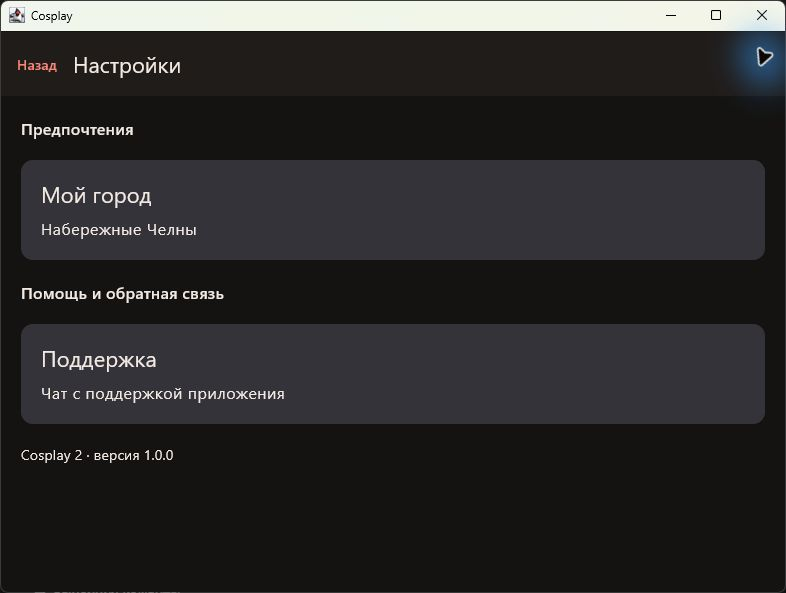
Диагностика: Нарушений ожидаемого поведения не обнаружено.

### S05 — Поддержка: недоступный сервис и черновик: PASS

- S05-1 PASS: Поддержка открыта: «Отправка сообщений пока недоступна», поле Сообщение и неактивная Отправить; история пустая.
  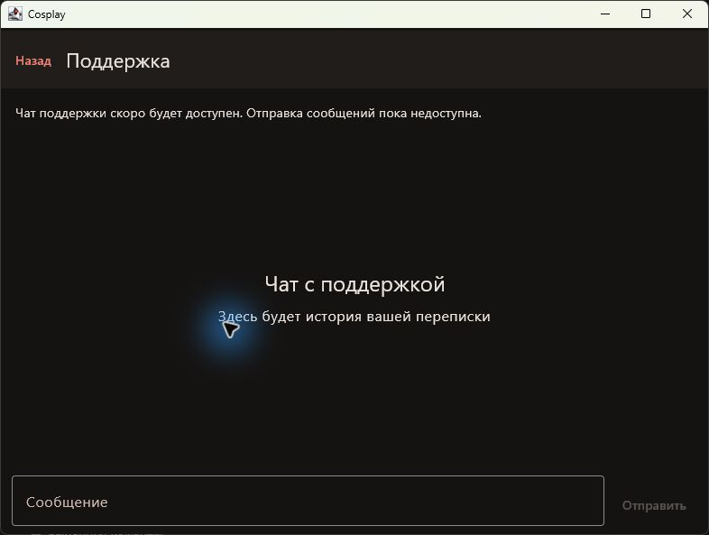
- S05-2 PASS: В поле виден SMOKE_DRAFT_7429; Отправить осталась неактивной, история пуста.
  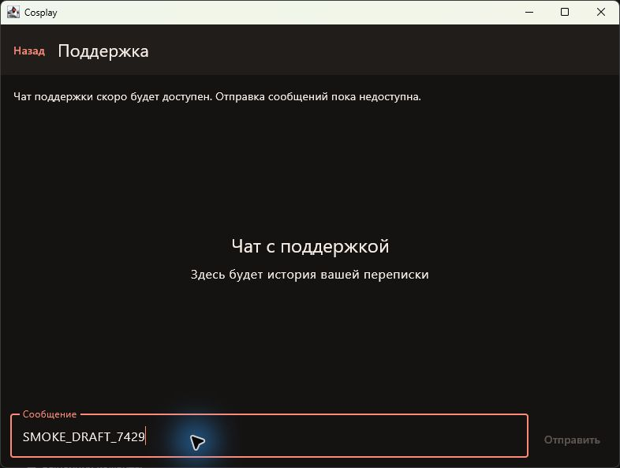
- S05-3 PASS: Назад из Поддержки открыл Настройки.
  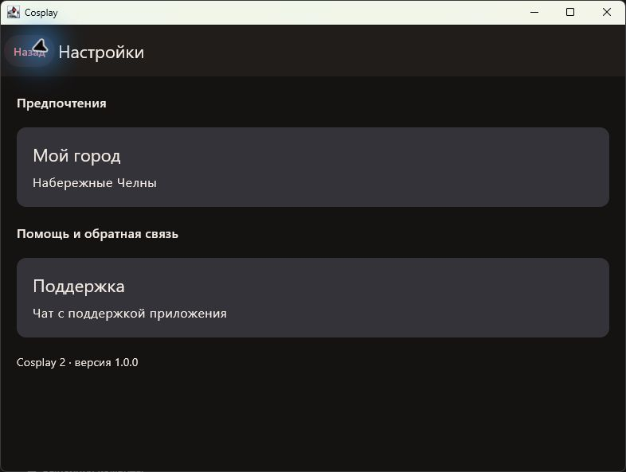
- S05-4 PASS: После повторного открытия Поддержки SMOKE_DRAFT_7429 сохранён; Отправить неактивна, ответов и отправленных сообщений нет.
  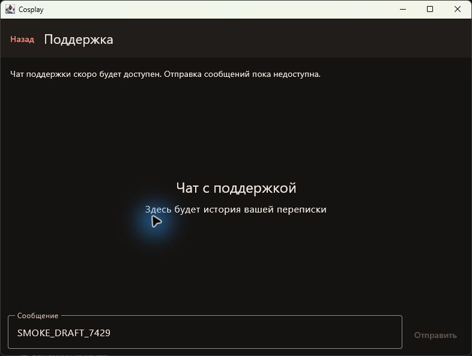
Диагностика: Нарушений ожидаемого поведения не обнаружено.

Полный цикл: PASS.
