Снимок фактического Android-прогона рабочих изменений поверх commit 040f9fc. run.json содержит SHA-256 проверенных исходников и базовый commit. После прогона добавлены только документация и копии свидетельств. Это исторический результат, а не проверка SHA нового коммита или удалённого CI. Время запуска — Asia/Omsk (UTC+06:00). Полные журналы, JUnit XML и APK остаются локально в build/verification/android-ready-20261024.

# Проверка Cosplay 2

Запуск: 10/24/2026 15:24:39; commit: 040f9fcbb85fcee03cd57046406b3509c7c066e0; source SHA-256: 7115f536a78aaba828c93c1de99c6a9a46e7c9a6eeb67582d0c73ec15c5058fb.

## Уровень 1 — код

- tests: exit 0, локальный журнал tests.log; `:core:model:desktopTest :data:festival:desktopTest :data:update:desktopTest :core:platform:desktopTest :composeApp:desktopTest --console=plain -I docs/build-upgrade/maven-mirror.init.gradle.kts`.
- compile: exit 0, локальный журнал compile.log; `:composeApp:compileKotlinDesktop :composeApp:compileAndroidMain :androidApp:assembleDebug -PandroidSmoke=true --console=plain -I docs/build-upgrade/maven-mirror.init.gradle.kts`.
- lint: exit 0, локальный журнал lint.log; `:androidApp:lintDebug --console=plain -I docs/build-upgrade/maven-mirror.init.gradle.kts`.

| Модуль | Тесты | Failures | Errors | Skipped |
| --- | ---: | ---: | ---: | ---: |
| core/model | 5 | 0 | 0 | 0 |
| data/festival | 5 | 0 | 0 | 0 |
| data/update | 7 | 0 | 0 | 0 |
| core/platform | 12 | 0 | 0 | 0 |
| composeApp | 40 | 0 | 0 | 0 |

Всего тестов: 69. При неуспешной команде XML может относиться к прошлой сборке и не подтверждает текущий запуск.

## Уровень 2 — UI через MCP

Платформа: Android 16 / API 36 / Pixel 9 emulator. Инструмент: Mobile MCP 1.0.12 / stdio / TypeScript SDK client. Сборка: APP_VERSION_NAME=1.0.2, отдельный debug package .smoke; часы эмулятора синхронизированы с компьютером; QWERTY IME проверена отдельно от первоначального handwriting-режима..
Android: emulator-5554, MCP device: Pixel_9; package: ru.flobsterable.cosplay2.smoke; APK SHA-256: 8E1A837897D1EE80BBA8813705C4C4D994239EBE00A7318F10E00D0E6BCBE21E.

### S01 — Каталог: поиск, пустой результат и восстановление: PASS

- S01-1 PASS: После синхронизации часов каталог загрузился с сервера: 61 событие; видна карточка АЗИЯ ЗОН | ВРЕМЯ ВЕДЬМ.
  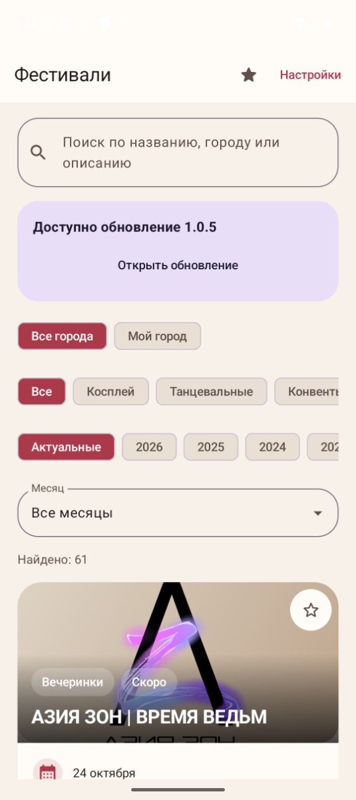
- S01-2 PASS: В поиске АЗИЯ: найден 1 фестиваль АЗИЯ ЗОН | ВРЕМЯ ВЕДЬМ вместо 61.
  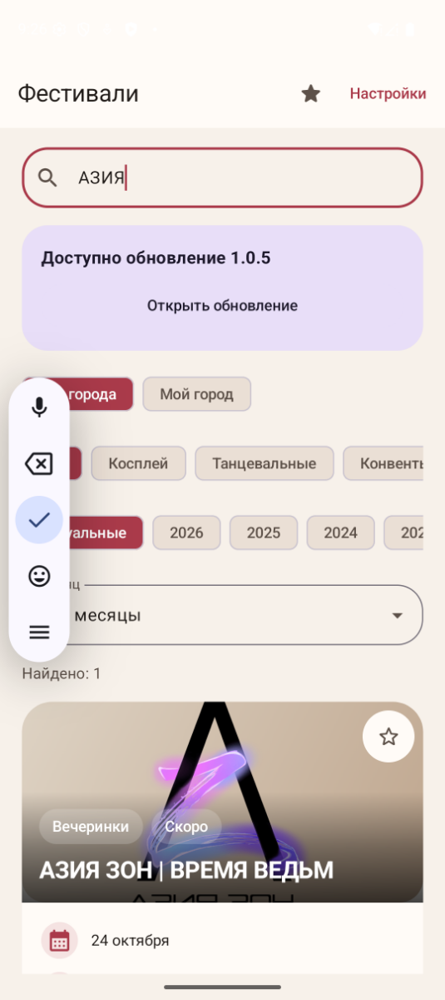
- S01-3 PASS: SMOKE_NO_MATCH_7429 даёт Ничего не найдено и подсказку снять фильтр или сократить запрос.
  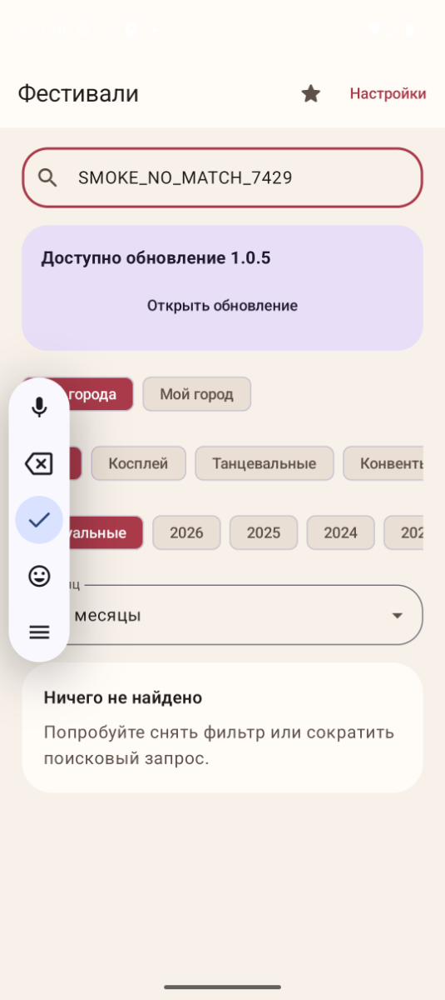
- S01-4 PASS: После очистки поиска восстановились 61 событие и карточки.
  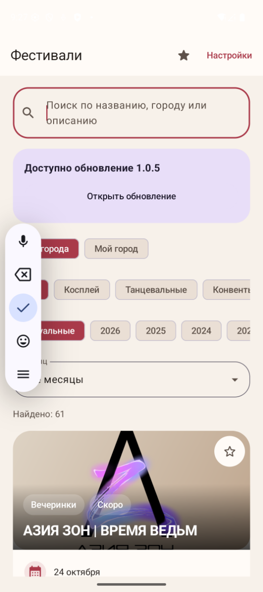
Диагностика: Ожидаемое поведение подтверждено через MCP.

### S02 — Год, месяц и сохранение фильтров: PASS

- S02-1 PASS: Выбран 2026; загружено 360 событий, первая карточка Hanzan party: special event, 9–10 января.
  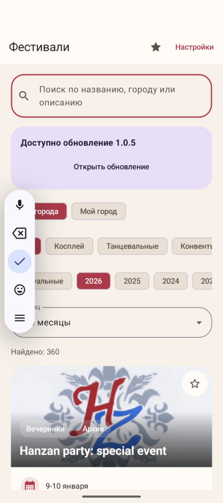
- S02-2 PASS: Фильтр Январь 2026 сократил каталог с 360 до 23 событий.
  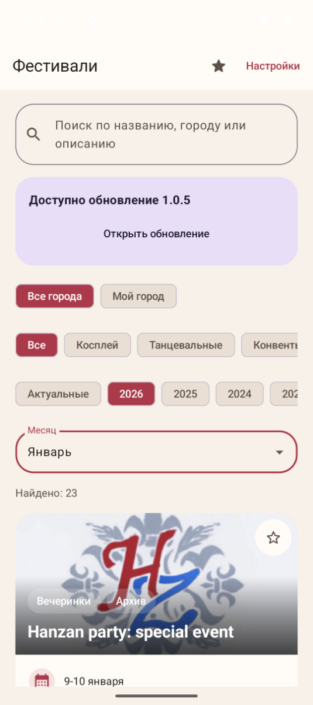
- S02-3 PASS: Системный BACK из Настроек вернул в каталог; 2026 и Январь сохранены. Дополнительный снимок S02-3-settings.png.
  
- S02-4 PASS: Выбран 2025, найдено 336 событий, месяц сброшен на Все месяцы.
  
Диагностика: Ожидаемое поведение подтверждено через MCP.

### S03 — Избранное: добавление, детали, возврат и удаление: PASS

- S03-1 PASS: Необычный Новый год! добавлен: звезда заполнена; semantics: Удалить из избранного. До добавления избранное пустое (S03-precondition.png).
  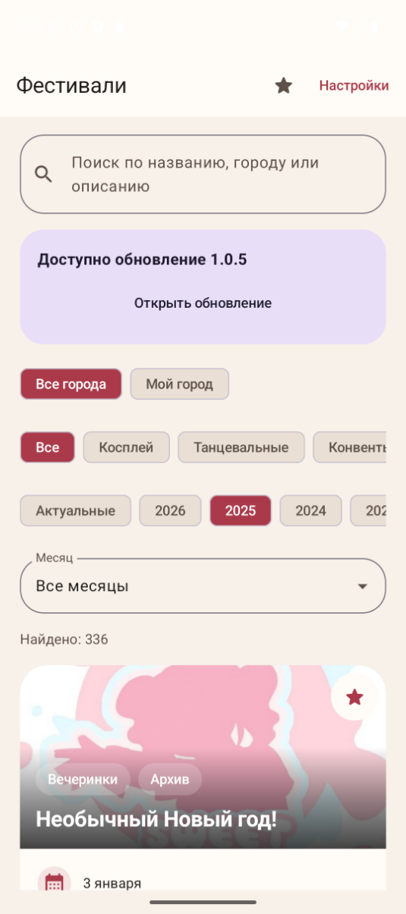
- S03-2 PASS: Избранное содержит Необычный Новый год!, 3 января, Набережные Челны.
  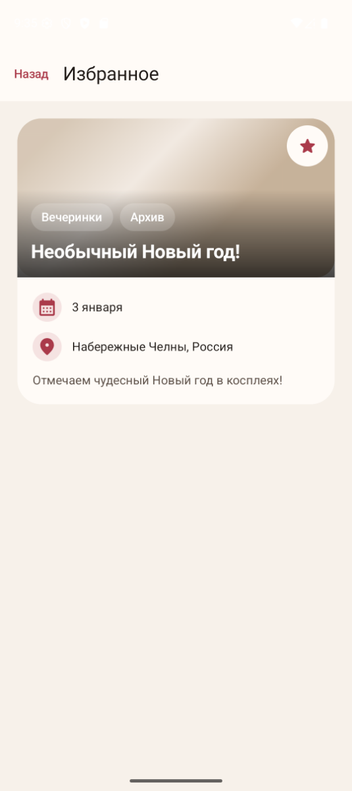
- S03-3 PASS: Детали Необычный Новый год! загружены: 3 января 2025, Набережные Челны, активная звезда.
  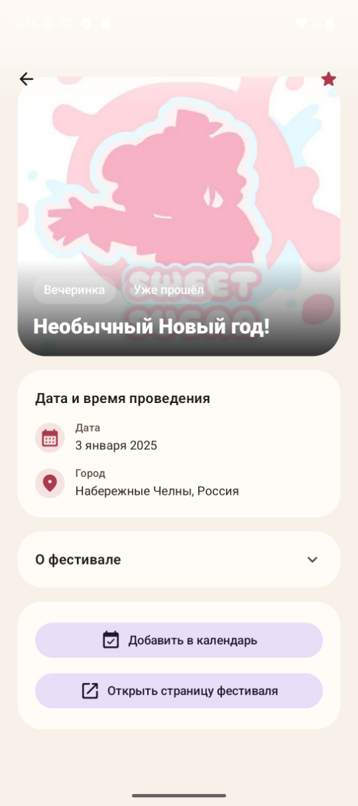
- S03-4 PASS: Системный BACK из деталей вернул в Избранное с той же карточкой.
  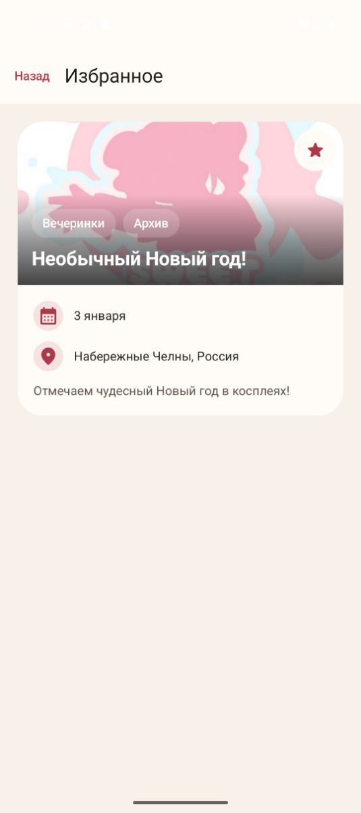
- S03-5 PASS: Добавленная тестом запись удалена; показано пустое избранное.
  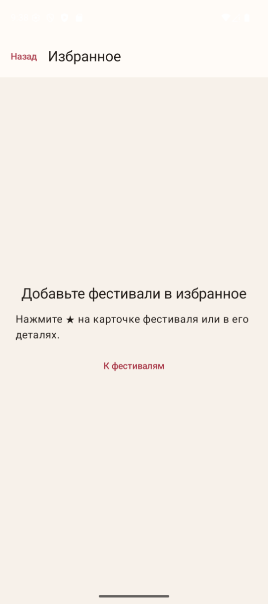
Диагностика: Ожидаемое поведение подтверждено через MCP.

### S04 — Мой город: выбор и фильтрация: PASS

- S04-1 PASS: В Настройках открыт Мой город с полем ввода; Сохранить неактивна до ввода.
  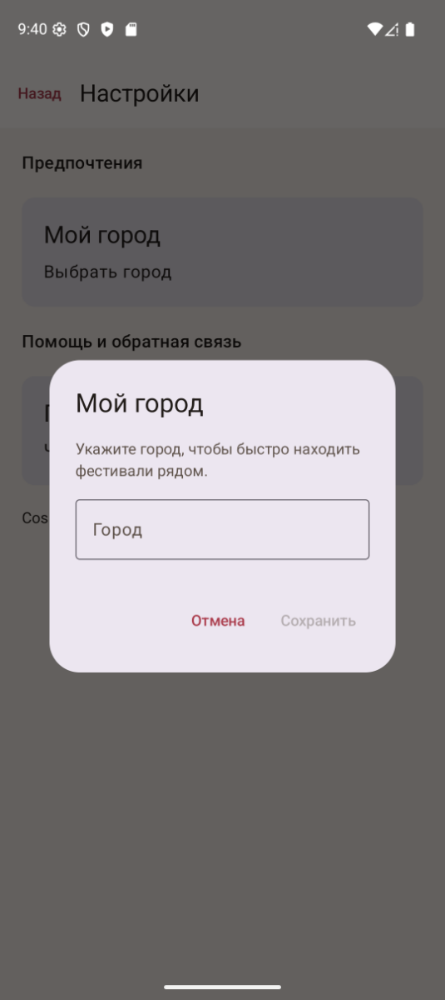
- S04-2 PASS: Настройки показывают сохранённый город Набережные Челны.
  
- S04-3 PASS: Мой город: Набережные Челны включился при сохранении; осталось 4 события. Все четыре карточки проверены: Необычный Новый год!, CH.FLEX FEST, Arkana Fest, Рубикон — Набережные Челны (S04-3-cities-1-2.png и S04-3-cities-3-4.png).
  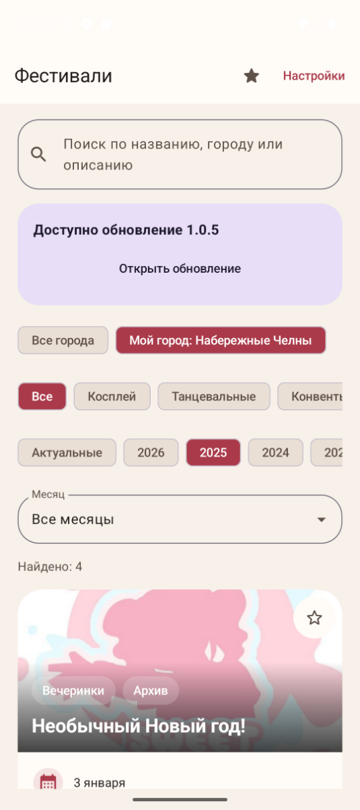
- S04-4 PASS: После Все города восстановлены 336 событий (S04-4-all.png). В Настройках город Набережные Челны сохранился.
  
Диагностика: Ожидаемое поведение подтверждено через MCP.

### S05 — Поддержка: недоступный сервис и черновик: FAIL

- S05-1 PASS: Поддержка сообщает об отключённой отправке; история пуста, поле Сообщение доступно, кнопка Отправить disabled.
  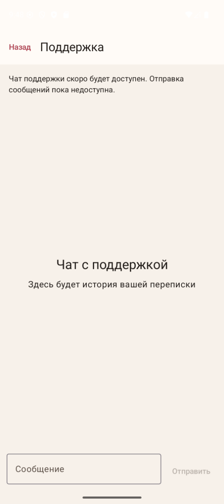
- S05-2 FAIL: С floating handwriting IME текст виден (S05-2.png). При обычной QWERTY IME поле визуально сжимается и SMOKE_DRAFT_7429 не виден, хотя дерево элементов содержит этот текст. Повторено после переоткрытия Поддержки (S05-ime-repeated.png). После BACK текст снова виден (S05-3-ime-hidden.png). Отправка остаётся disabled.
  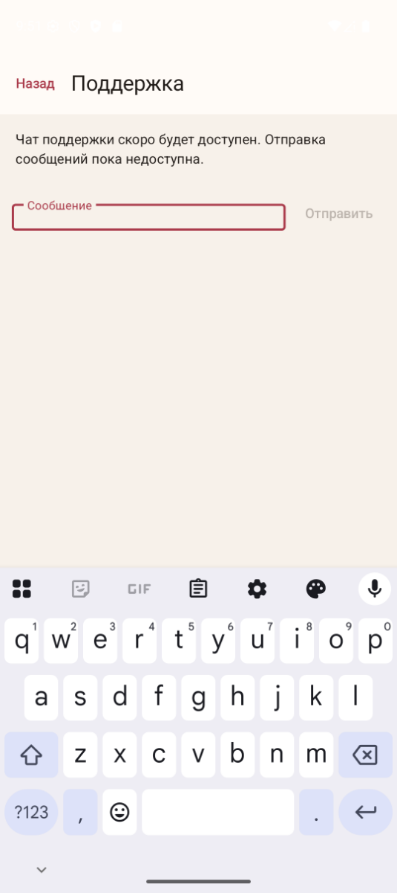
- S05-3 PASS: На обычной QWERTY IME первый системный BACK скрыл клавиатуру, оставив Поддержку и SMOKE_DRAFT_7429 (S05-3-ime-hidden.png); второй BACK вернул Настройки. Первоначальный handwriting-режим возвращал Настройки одним BACK (S05-3-handwriting-attempt.png).
  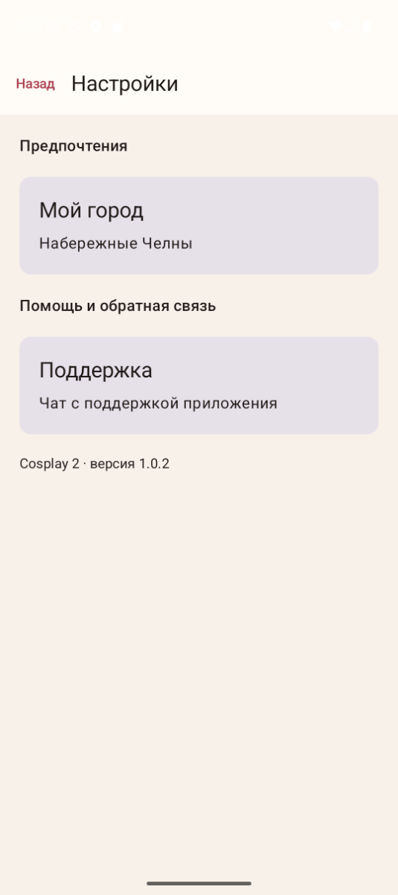
- S05-4 PASS: После повторного открытия Поддержки SMOKE_DRAFT_7429 сохранился, отправка disabled и история пустая.
  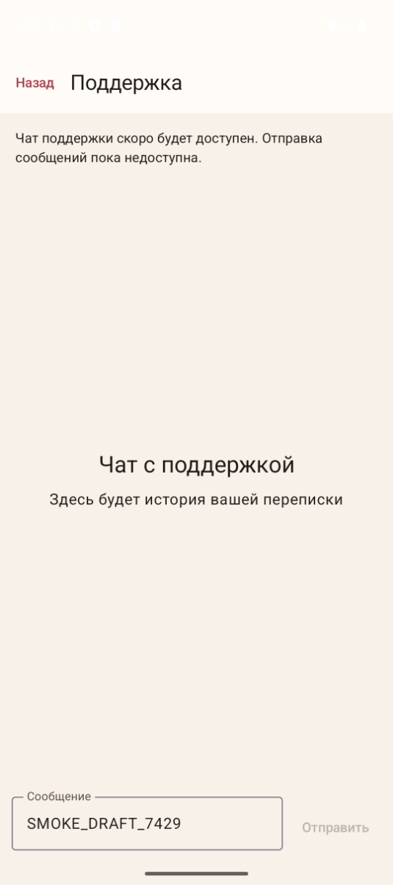
Диагностика: При обычной QWERTY IME текст черновика визуально скрыт, но сохранён в semantics и появляется после BACK. Повторено дважды. Вероятное место: SupportScreen.kt, Column с padding(padding).imePadding(), в сочетании с adjustResize в AndroidManifest.xml; возможна двойная обработка IME insets. Это гипотеза причины, layout/insets нужно проверить отдельным Bug Fix. Handwriting-режим отличается: BACK сразу вернул Настройки; после перехода на QWERTY первый BACK скрывает IME, второй открывает Настройки.

Полный цикл: BLOCKED/FAIL — UI не подтверждён полностью.
